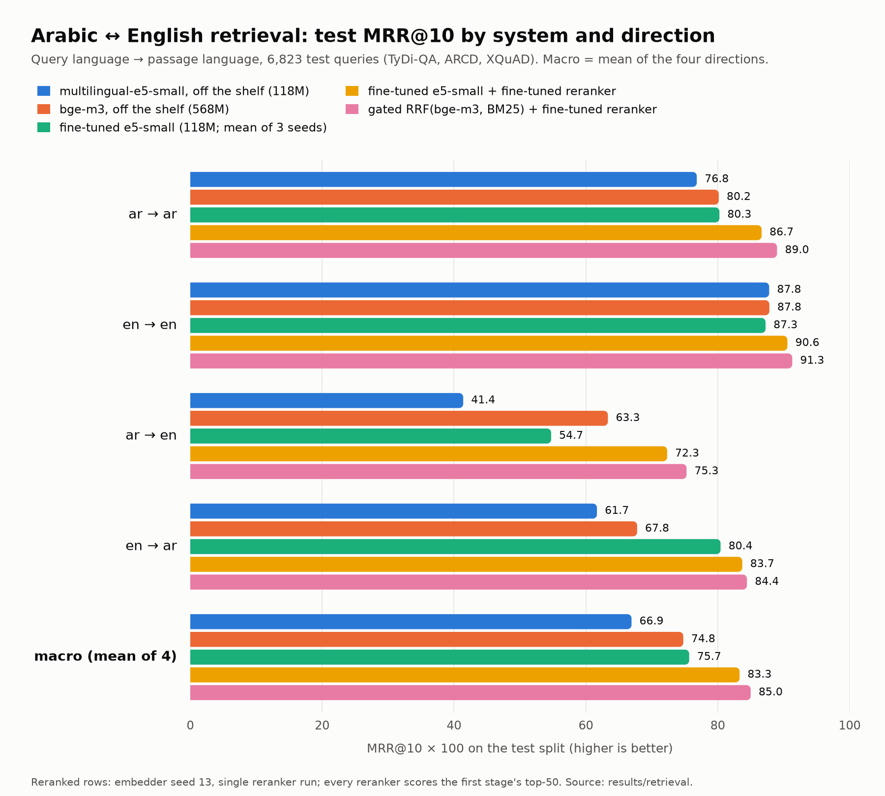
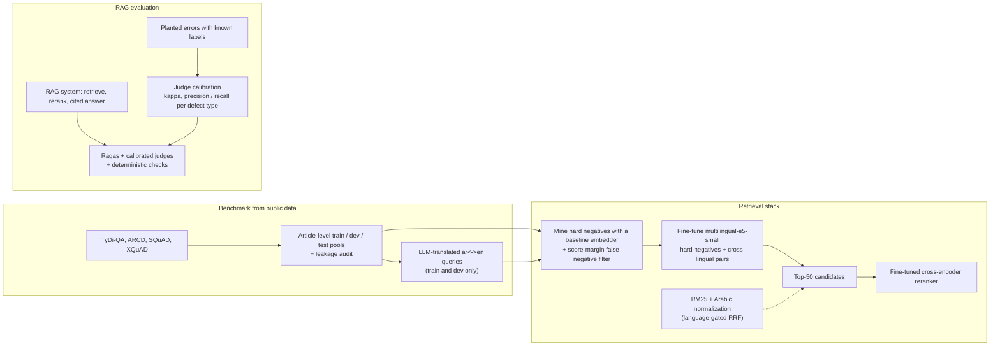

# Arabic-English retrieval: benchmark, hard-negative fine-tuning, calibrated RAG evaluation

[](https://github.com/mahmoudzahran01/arabic-english-retrieval-eval/actions/workflows/ci.yml)

Retrieval over mixed Arabic and English text is hard because Arabic's rich morphology and spelling variation defeat lexical matching, and a small multilingual
embedder loses most of its quality when an Arabic query has to find an English passage (multilingual-e5-small: MRR@10 41.4 for ar->en against 87.8 for en->en),
which is exactly the situation of a RAG system that serves Arabic users over bilingual documents.

This repository contains:

* **A bilingual retrieval benchmark built only from public datasets** (TyDi-QA, ARCD, SQuAD, XQuAD): 24.5k passages, 31.4k queries, article-level disjoint
  train/dev/test pools, an independent leakage audit, and parallel XQuAD test slices that isolate ar->ar, en->en, **ar->en** and en->ar.
* **Fine-tuning of a 118M embedder and a cross-encoder reranker** with mined hard negatives and cross-lingual pairs: macro MRR@10 66.9 -> 75.7 for the embedder
  alone (above the 568M bge-m3 at 74.8) and 83.3 with the fine-tuned reranker (ar->en 41.4 -> 72.3), plus findings on false negatives, hybrid fusion and Arabic normalization.
* **A RAG-evaluation study**: LLM judges calibrated against planted errors (Cohen's kappa 0.42 -> 0.97), a deterministic wrong-language check that caught a defect
  Ragas missed, and an end-to-end acceptable-answer rate that went from 59.4% to 85.0%.

## Results

Test-split MRR@10 x 100 (percentage points). ar->ar and en->en are macro-averages of their slices; the other two directions come from XQuAD's parallel questions.
"+-" is the standard deviation over 3 training seeds; rows without it are a single run (see Limitations). Full tables, every slice and metric, paired bootstrap CIs:
[`docs/retrieval/RESULTS.md`](docs/retrieval/RESULTS.md).

| System | ar->ar | en->en | ar->en | en->ar | macro |
|---|---:|---:|---:|---:|---:|
| BM25 (normalized + light stemmer) | 76.1 | 79.5 | 3.2 | 1.2 | 40.0 |
| multilingual-e5-small, off the shelf (118M) | 76.8 | 87.8 | 41.4 | 61.7 | 66.9 |
| bge-m3 dense, off the shelf (568M) | 80.2 | 87.8 | 63.3 | 67.8 | 74.8 |
| e5-small + BM25(stem), language-gated RRF | 80.4 | 86.4 | 41.4 | 61.7 | 67.5 |
| **fine-tuned e5-small** (hard negatives + cross-lingual pairs; 3 seeds) | 80.3 ± 0.2 | 87.3 ± 0.2 | 54.7 ± 0.6 | 80.4 ± 0.4 | 75.7 ± 0.1 |
| baseline e5-small -> top-50 -> off-the-shelf mMiniLM reranker | 85.3 | 90.9 | 65.7 | 80.0 | 80.5 |
| baseline e5-small -> top-50 -> **fine-tuned reranker** | 87.2 | 91.0 | 68.9 | 83.8 | 82.7 |
| **fine-tuned e5-small -> top-50 -> fine-tuned reranker** | 86.7 | 90.6 | 72.3 | 83.7 | 83.3 |
| gated RRF(bge-m3, BM25) -> top-50 -> fine-tuned reranker | 89.0 | 91.3 | 75.3 | 84.4 | 85.0 |

(Reranked rows use embedder seed 13 and a single reranker training run; every reranker scores the first stage's top-50.)

<picture>
  <source media="(prefers-color-scheme: dark)" srcset="docs/img/mrr_by_system_dark.png">
  
</picture>

RAG evaluation (180 questions over a 220-passage bilingual XQuAD corpus; 180 planted-error items; details in [`docs/rageval/RESULTS.md`](docs/rageval/RESULTS.md)):

| Result | Value | Source |
|---|---|---|
| Judge vs planted ground truth, Qwen3-4B end-to-end judge: one-shot prompt -> decomposed pipeline (kappa, test split, n = 91) | 0.42 -> 0.97 | [`results/rageval/calibration_test.md`](results/rageval/calibration_test.md) |
| Same, Gemma 4 26B-A4B (the set saturates, so it cannot rank strong judges) | 0.95 -> 1.00 | same |
| Baseline answers written in the wrong language, all to English questions; no Ragas metric flags them | 34 of 126 (27%) | [`results/rageval/answers_A_baseline.jsonl`](results/rageval/answers_A_baseline.jsonl) |
| Acceptable-answer rate, baseline -> reranked + explicit output-language prompt | 59.4% [52.2, 66.7] -> 85.0% [79.4, 90.0] | [`results/rageval/ab_test.md`](results/rageval/ab_test.md) |
| Same comparison on 48 fresh questions | 58.3% -> 85.4% | [`results/rageval/ab_test_heldout.md`](results/rageval/ab_test_heldout.md) |

## Pipeline



## Key findings

Retrieval ([`docs/retrieval/RESULTS.md`](docs/retrieval/RESULTS.md), methods in [`docs/retrieval/EXPLAINER.md`](docs/retrieval/EXPLAINER.md)):

* **Hard negatives and cross-lingual pairs carry the embedder gain.** In-batch negatives only: 70.8 macro; + 1 mined hard negative: 73.0 (3 seeds); + LLM-translated
  cross-lingual pairs: 75.7. The final 118M model ties the 568M bge-m3 on ar->ar and en->en, beats it by 12.6 points on en->ar, and is still 8.2 behind it on ar->en.
* **Reranking is the largest single lever for the cross-lingual directions.** A fine-tuned 118M cross-encoder over the top-50 lifts the baseline e5-small from 66.9 to 82.7
  macro (ar->en 41.4 -> 68.9); it costs a median 94 ms for 50 candidates on a shared GPU.
* **False negatives are real and filtering them is direction-dependent.** An LLM audit found that 8.8% of the top-3 mined negatives contain the answer (19.4% when the
  candidate outscores the gold). A 0.02-cosine margin filter is worth +1.2 macro: +4.1 on ar->en but -1.3 on en->ar relative to no filter.
* **Hybrid search needs a language gate.** Equal-weight RRF of dense + BM25 adds 3.6 points on ar->ar but collapses cross-lingual retrieval (en->ar 61.7 -> 26.9) because BM25's
  rank-1 across scripts is noise; fusing only when query and passage languages match keeps the gain.
* **Arabic normalization is for the lexical channel only.** Normalization + a light stemmer lifts BM25 ar->ar from 67.4 to 76.1; feeding normalized text to the dense models lowers it (76.8 -> 74.2).

Negative and null results, kept in the report on purpose:

* Random negatives are worth nothing (70.9 vs 70.8 for in-batch only); stricter false-negative filtering is worse, not better (margin 0.05: 71.5; dropping same-article candidates: 71.5).
* More epochs and bigger batches do not help at this scale (3 epochs: 72.4 vs 73.0; a 512-example batch with 32 optimizer steps: 70.3); 25% of the data already gives about 80% of the gain.
* English does not improve (87.8 -> 87.7), and XQuAD-en gets 1.8 points worse: a mixed-language fine-tune trades a little English for Arabic and cross-lingual quality.
* A reranker trained on random negatives is worse on English than the off-the-shelf one it started from (MRR@10 85.9 vs 90.9).
* `paraphrase-multilingual-MiniLM` is a similarity model, not a retrieval model (ar->ar 40.2).

RAG evaluation ([`docs/rageval/RESULTS.md`](docs/rageval/RESULTS.md), concepts in [`docs/rageval/EXPLAINER.md`](docs/rageval/EXPLAINER.md)):

* **Calibrate a judge before trusting it.** On 180 planted errors (12 item types: 9 defect types and 3 correct controls; labels true by construction), a small one-shot judge reaches kappa 0.42; claim-level verification on a
  deterministic sentence split, a reference-guided correctness rubric, a cited-passage check and deterministic language / abstention checks reach 0.97. Part of the gain comes from the
  deterministic checks; an LLM claim extractor catches only 33% of invented sentences because it silently drops them.
* **The deterministic check found what Ragas could not.** 27% of the baseline's real answers were in the wrong language (the model followed the passage's language, not the question's).
  Adding an explicit output-language instruction and reranking top-10 -> top-3 moved the acceptable-answer rate from 59.4% to 85.0% (McNemar: 51 fixed, 5 broken).
* **Ragas misbehaves in specific, documented ways:** answer relevancy is forced to 0 for correct refusals, FactualCorrectness collapses with bare-span references (0.10 vs 0.53 with sentence
  references), while context recall / precision do react to real retrieval misses (1.00 / 0.90 vs 0.29 / 0.29).
* Null result: chunking passages to avoid embedder truncation did not help (hit@3 0.831 vs 0.812, inside the intervals).

## Reproduce

Everything in the tables and the chart regenerates from the committed result files on a laptop, with no GPU and no model downloads:

```bash
git clone https://github.com/mahmoudzahran01/arabic-english-retrieval-eval && cd arabic-english-retrieval-eval
python -m venv .venv && source .venv/bin/activate
pip install -e ".[dev]"
make test      # unit tests + "the committed results regenerate the committed tables and reports, byte for byte"
make report    # results/retrieval -> tables.md -> docs/retrieval/RESULTS.md and docs/img/*.png
```

From scratch (GPU and an OpenAI-compatible LLM endpoint required; commands, stage table and time estimates in
[`docs/retrieval/REPRODUCING.md`](docs/retrieval/REPRODUCING.md) and [`docs/rageval/REPRODUCING.md`](docs/rageval/REPRODUCING.md)):

```bash
pip install -e ".[dev,train]"                       # add ,rageval for the Ragas part
cp .env.example .env && set -a && source .env && set +a        # LLM endpoints (GEMMA_*, QWEN_*): translation, false-negative audit, generator, judges
bash scripts/retrieval/01_data.sh                   # public datasets -> pools, LLM translation of cross-lingual train/dev queries, leakage audit
bash scripts/retrieval/02_baselines.sh              # BM25, e5-small, MiniLM, bge-m3, RRF hybrids
bash scripts/retrieval/03_mining.sh                 # hard-negative mining + LLM false-negative audit
bash scripts/retrieval/04_train_embedders.sh        # ~35 embedder fine-tuning runs (dev + test evaluation each)
bash scripts/retrieval/05_rerankers.sh              # reranker fine-tuning, rerank evaluations, 568M reference reranker, latency
bash scripts/retrieval/06_report.sh                 # publish small results, regenerate tables, RESULTS.md, chart
bash scripts/rageval/01_data_and_index.sh           # then 02 ... 05: baseline RAG, planted set + judges, A/B experiment, human hook
```

Hardware and time of the published runs: one **NVIDIA GB10 (DGX Spark)**, bf16, GPU memory shared with other jobs (so timings are noisy). A single embedder run took 1-30 minutes
(5-13 typical; peak GPU memory 5.2-15.9 GB), a reranker training or evaluation 15-30 minutes, the LLM translation of 5,000 queries about 2 hours at concurrency 2. The RAG-evaluation
LLM calls were rate-bound (Gemma 4 26B-A4B shared, 3-20 calls/min), which is why some of its parts run on subsets, as stated in its report. A from-scratch rebuild will not
reproduce the published numbers exactly: the LLM translations of the cross-lingual training queries are not redistributed (see [`DATA.md`](DATA.md)) and GPU training is not bit-reproducible
(the same configuration and seed twice gave macro MRR@10 70.67 vs 70.69; seed-to-seed std is about 0.2).

## Limitations

* **ar->en is still the weak direction for the embedder alone**: the fine-tuned e5-small reaches 54.7 against 63.3 for off-the-shelf bge-m3. The reranker closes most of it (72.3), the
  strongest stack (bge-m3 + BM25, gated, + fine-tuned reranker) reaches 75.3.
* **Single-seed rows.** Only the headline comparisons have 3 seeds; every other ablation is one run, and differences below about 1 point there are noise. The reranked rows use one reranker
  training run, and the 568M reference reranker was scored on a 1,050-query subset.
* **Selection effects.** About 30 embedder configurations were compared on the test split (final checkpoints, no checkpoint selection, dev used for model selection only), so the best row is mildly
  optimistic. The dev set is translated the same way as the training data, so it slightly over-rewards extra cross-lingual training.
* **QA-derived data.** All data is Wikipedia-style factoid QA: one gold passage per query (correct but unlabelled passages count as errors), 4-5k-passage test corpora (tiny next to production),
  parallel XQuAD content for the cross-lingual slices, and LLM-translated cross-lingual training queries that are cleaner than real code-mixed Arabic. Nothing here measures the gain on an enterprise corpus.
* **LLM-judge caveats.** The planted errors are synthetic, so kappa against them is an upper bound on kappa against real errors; the set saturates for strong judges; the judge pipeline was
  designed on dev items; per-defect-type test counts are 4-15. Two judge models were compared on one task family. **No human agreement is reported**: the 40-item labelling sheet and the
  scoring script exist but were tested on synthetic labels only.
* **RAG-eval scope.** 220-passage corpus, 180 questions; Ragas ran on a 26-question subset because the shared judge was slow, so its per-cell numbers are descriptions, not benchmarks.
  The original runs used a Qdrant + HTTP embed service backend; this repository ships the equivalent in-process exact-cosine retriever the runs fell back to.
* **Latency numbers** were taken on a machine shared with other jobs; ratios are more trustworthy than absolutes.

## Repository layout

```
.
├── README.md  DATA.md  LICENSE  Makefile  pyproject.toml  .env.example
├── src/arretrieval/
│   ├── config.py                 environment-driven paths and LLM endpoints
│   ├── retrieval/                benchmark build, leakage audit, metrics, BM25 / dense / hybrid evaluation,
│   │                             hard-negative mining, embedder + reranker training, reports
│   └── rageval/                  RAG system, planted-error set, LLM judges, Ragas adapters, agreement statistics
├── scripts/
│   ├── retrieval/01..06_*.sh     numbered stages of the retrieval study
│   ├── rageval/01..05_*.sh       numbered stages of the RAG-evaluation study
│   ├── lib.sh                    retry / idempotency helpers
│   └── make_chart.py             docs/img/*.png from the committed results
├── results/
│   ├── retrieval/                per-system metrics, per-query arrays, tables.md, data card (manifest, leakage audit)
│   └── rageval/                  judge verdicts, answers without passage text, calibration / A-B / bias / Ragas reports
├── docs/
│   ├── retrieval/                RESULTS.md (generated), EXPLAINER.md (methods), REPRODUCING.md
│   ├── rageval/                  RESULTS.md, EXPLAINER.md, REPRODUCING.md, HUMAN_LABELING.md
│   └── img/                      the chart (light and dark)
├── tests/                        CPU-only unit tests + "committed results regenerate committed reports" checks
├── requirements/rageval.lock.txt exact package versions of the published RAG-evaluation run
└── .github/workflows/ci.yml      ruff + pytest on CPU
```

## License

Code: MIT (see [`LICENSE`](LICENSE)). Data and dataset-derived strings keep their source licences (Apache-2.0, MIT, CC BY-SA 4.0); see [`DATA.md`](DATA.md).
